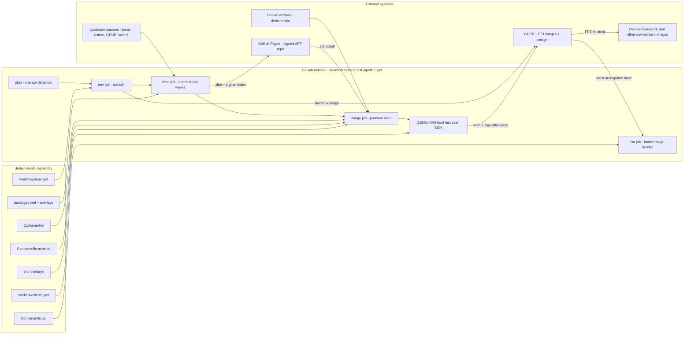

# Architecture overview

debian-bootc has no long-running application services. Its "services" are build artifacts and CI stages: a build-environment image, custom `.deb` packages published as a signed APT repository, bootable OCI images (full and minimal), and an installer ISO. All stages run in the shared `DaemonCores/DaemonCores-CI` reusable workflow called from `.github/workflows/pipeline.yml` [src: file: .github/workflows/pipeline.yml:71]. Narrative detail: [architecture](../architecture.md).

## Apps / services

| Service | Port | Tech | Role |
|---------|------|------|------|
| Build environment `ghcr.io/<owner>/<repo>-buildenv` | N/A | buildah, recipe in `workflows/env.yml`, `debian:trixie` base, Rust via rustup [src: file: workflows/env.yml:3] [src: file: workflows/env.yml:15] | Toolchain image the per-package build jobs run inside; rebuilt monthly or on `rebuild_env` dispatch [src: file: workflows/env.yml:5] [src: file: .github/workflows/pipeline.yml:28] |
| `.deb` builder (`bootc-debs-builder`) | N/A | Shared workflow driven by `workflows/bootc-debs-builder/packages.yml` | Builds 16 custom packages (bootc, ostree, libcomposefs, bootupd, signed GRUB, kernel image + module packages, ifupdown2/systemd-timesyncd repacks, firstboot-user-setup, fisherman, bootc-installer) in dependency waves [src: file: workflows/bootc-debs-builder/packages.yml:2] |
| APT repository `https://daemoncores.github.io/debian-bootc/` | 443 (HTTPS) | GitHub Pages, GPG-signed | Distributes the custom `.deb`s; images trust it through a key pinned by SHA-256 [src: file: Containerfile:41] [src: file: Containerfile:78] [src: file: docs/architecture.md:39] |
| Full image (`Containerfile`) | N/A | Podman, `FROM debian:trixie`, bootc/OSTree | General-purpose bootable image: kernel, firmware, SSH, Podman, ifupdown2, first-boot setup; autoupdate variant only [src: file: Containerfile:5] [src: file: Containerfile:99] [src: file: Containerfile.minimal:80] |
| Minimal image (`Containerfile.minimal`) | N/A | Podman, `FROM debian:trixie`, bootc/OSTree | Reduced multi-arch image; label `org.daemoncores.autoupdate-variants="lock,autoupdate"` yields `_autoupdate` and `_lock` tag families [src: file: Containerfile.minimal:66] [src: file: Containerfile.minimal:82] |
| Installer ISO (`Containerfile.iso`) | N/A | `FROM ghcr.io/daemoncores/debian-bootc:latest-${ARCH}-autoupdate`, cage, fisherman, bootc-installer, bootc-image-builder | amd64 live installer; GTK4 wizard drives `bootc install to-filesystem` [src: file: Containerfile.iso:28] [src: file: Containerfile.iso:5] [src: file: docs/architecture.md:90] |
| Boot test harness | SSH | QEMU/KVM + UEFI, manifest `workflows/tests.yml` | Installs each image to a virtual disk, boots it, runs tests over SSH; a failure blocks the push [src: file: workflows/tests.yml:1] |
| Container registry GHCR | N/A | OCI registry + cosign (repository key) | Hosts signed images and multi-arch manifest lists [src: file: docs/architecture.md:102] |
| Docs wiki sync | N/A | `DaemonCores-CI/.github/workflows/docs-wiki-sync.yml@main` | Syncs `docs/**` to the GitHub wiki [src: file: .github/workflows/docs-wiki-sync.yml:11] |

## Architecture diagram

## Key patterns

### Thin-caller CI
`.github/workflows/pipeline.yml` only declares triggers (push to `main`, monthly cron, `workflow_dispatch` checkboxes), permissions and concurrency; the whole job graph (plan, env, debs, image, iso) lives in `DaemonCores-CI/full-pipeline.yml@main` [src: file: .github/workflows/pipeline.yml:3] [src: file: .github/workflows/pipeline.yml:17]. On push, a plan job diffs the change so untouched stages auto-skip; a newer push cancels the in-progress run [src: file: .github/workflows/pipeline.yml:8] [src: file: .github/workflows/pipeline.yml:65].

### Declarative manifests consumed by shared workflows
Repo-specific behaviour is expressed as YAML data, not workflow code: `workflows/env.yml` (build-env phases), `workflows/bootc-debs-builder/packages.yml` (one entry per package with `deps`, `sources`, `env`, verbatim `build` script) and `workflows/tests.yml` (runtime tests) [src: file: workflows/env.yml:3] [src: file: workflows/bootc-debs-builder/packages.yml:4] [src: file: workflows/tests.yml:5]. `deps` become topological build waves so independent packages build in parallel [src: file: docs/architecture.md:29].

### Content-hash caching
Only the declared `sources` paths and non-secret `env` of a package are hashed; an unchanged hash restores the previously published `.deb` instead of rebuilding [src: file: workflows/bootc-debs-builder/packages.yml:7] [src: file: docs/architecture.md:39]. Images use an input hash over Containerfiles, package metadata, base-image digest, arch and update mode [src: file: docs/architecture.md:58]. An undeclared build input produces a stale cache hit.

### Filesystem overlays plus OSTree layout migration
Each Containerfile `COPY`s a directory under `src/` whose paths mirror `/` (`debianpreinstall`, `bootcpreinstall`, then `debianpostinstall` or `minimalpostinstall`) [src: file: Containerfile:54] [src: file: Containerfile:75] [src: file: Containerfile:173] [src: file: Containerfile.minimal:227]. The final phase relocates `/home`, `/root`, `/mnt`, `/srv`, `/opt` and locale data into `/var` via symlinks and links `/ostree` to `/sysroot/ostree`, so the read-only `/usr` can be swapped atomically [src: file: Containerfile:170]. Kernel relocation and dracut initramfs are done by `bootc-finalize`, also hooked into `/etc/kernel/postinst.d` so downstream images get it automatically [src: file: workflows/bootc-debs-builder/bootcpostinstall/usr/local/bin/bootc-finalize:3] [src: file: workflows/bootc-debs-builder/bootcpostinstall/etc/kernel/postinst.d/zz-bootc-finalize:5].

### Test-gated, signed publication
Images are pushed and cosign-signed only after the QEMU boot tests pass; every test must declare a `diag` command or the harness refuses to run [src: file: workflows/tests.yml:9] [src: file: docs/architecture.md:64]. Trust is pinned end-to-end: APT key bytes checked against `BOOTC_GPG_SHA256`, images signed with the repository's cosign key and verified by hosts [src: file: Containerfile:81] [src: file: docs/architecture.md:101].

## Code organization

The repository is organized by build layer, not by feature. Root-level `Containerfile*` files define the image layer (the CI discovers every `Containerfile*` and derives the tag family from the filename) [src: file: docs/architecture.md:54]; `src/<phase>/` holds per-phase filesystem overlays; `workflows/bootc-debs-builder/` holds the package layer (manifest, patches, `preinstall/output/<pkg>/DEBIAN` metadata, `*postinstall` payload dirs); `workflows/env.yml` the build-env layer; `workflows/tests.yml` the validation layer; `kernel/` and `kernel/modules/` the kernel configuration inputs (`kernel/config` plus per-target fragments `arm`, `generic`, `rk3588`, `rpi3`–`rpi5`, `x86_64`); `scripts/gen-recipe.py` is the only Python helper [src: file: workflows/bootc-debs-builder/kernel/config:1] [src: file: scripts/gen-recipe.py:2]. See [repo-map](../repo-map.md).

## Data flow

Source inputs (upstream tarballs/git, Debian packages to repack, repo overlays) flow into the debs job, which produces `.deb`s and a signed APT index on GitHub Pages [src: file: docs/architecture.md:39]. Image builds start `FROM debian:trixie`, add the APT repo with its pinned key, `apt install` the custom stack, apply overlays and the OSTree migration, then the image is booted under QEMU, tested over SSH and pushed/signed to GHCR [src: file: Containerfile:75] [src: file: docs/architecture.md:56]. GHCR images then feed the ISO build (`latest-${ARCH}-autoupdate`), downstream projects such as `DaemonCores-VE`, and installed systems that upgrade in place through OSTree [src: file: Containerfile.iso:28] [src: file: docs/architecture.md:12].

Sequence diagrams:
- [CI build and publish pipeline](sequences/ci-build-publish.md)
- [Image boot test and rollback](sequences/image-boot-test.md)
- [ISO installation](sequences/iso-install.md)

## Legacy / migrations

| Area | Current state | Target |
|------|---------------|--------|
| Installer | Graphical cage + bootc-installer (GTK4) + fisherman ISO; Anaconda/Kickstart flow replaced [src: file: docs/architecture.md:93] | Done; the relative locale symlink kept for Anaconda compatibility is a leftover rationale |
| Architectures | arm64 build/test support present in CI, manifests and tests (`arch` gating), ISO amd64-only, full matrix "still being validated" [src: file: docs/architecture.md:109] | Validated amd64 + arm64 tag matrix <!-- TODO: ask user --> whether arm64 ISO is planned |
| Kernel variant | both images: `KERNEL_VARIANT=minimal` via the `Provides: linux-image-minimal-<arch>` of the custom `daemoncores-kernel-<kver>` (kernel.org tarball plus patches) built from `workflows/bootc-debs-builder/kernel/config` [src: file: Containerfile.minimal:107] [src: file: Containerfile:27] | One project kernel per arch for both images (see [minimal](../minimal.md)) |
| Module signing | `config.yml` default is `both`; comment marks `both` as "(future)" and calls `nosign` the default [src: file: config.yml:4] [src: file: config.yml:11] | <!-- TODO: ask user --> whether `both` is the intended live default |
| Image tag separator | Docs describe `<variant>_<arch>_<mode>`; `Containerfile.iso` pulls hyphenated `latest-${ARCH}-autoupdate` [src: file: docs/architecture.md:73] [src: file: Containerfile.iso:28] | <!-- TODO: ask user --> canonical separator |
| Raspberry Pi / Gallium disk images | `run_img_rpi` dispatch opt-in forwarded (default off); `run_img_gallium` intentionally not forwarded [src: file: .github/workflows/pipeline.yml:77] | N/A — Gallium not shipped by this repo |
