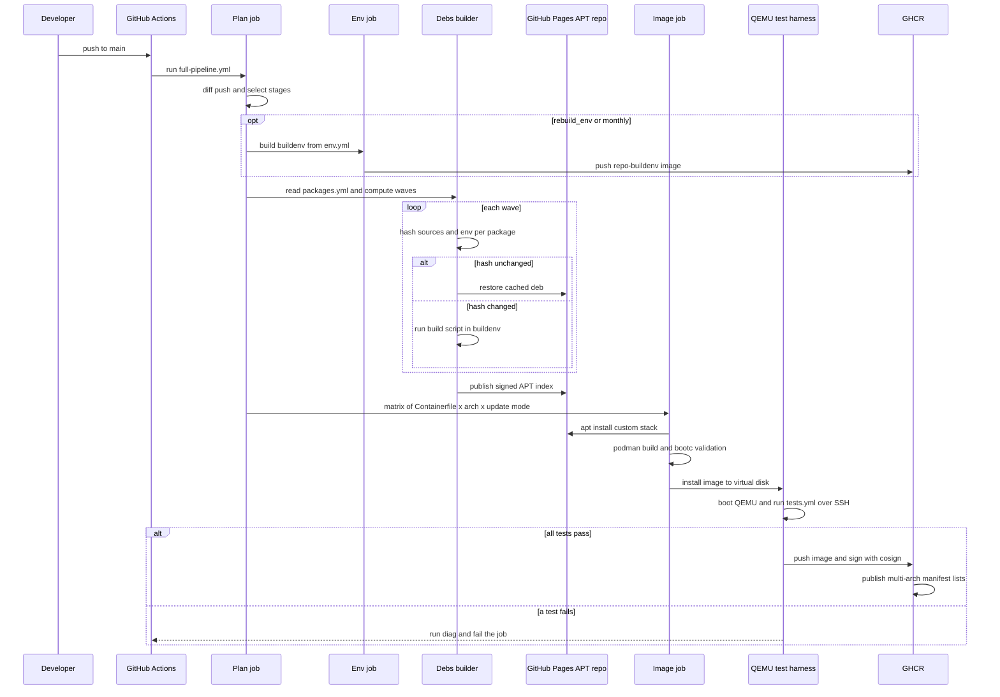

# CI build and publish pipeline

This sequence describes how a change becomes published packages and images. It starts when a push to `main` (or a monthly cron / manual dispatch) triggers `.github/workflows/pipeline.yml`, which delegates to the shared `DaemonCores-CI/full-pipeline.yml@main` [src: file: .github/workflows/pipeline.yml:17] [src: file: .github/workflows/pipeline.yml:71]. It ends with signed `.deb`s on GitHub Pages and cosign-signed images on GHCR [src: file: docs/architecture.md:39] [src: file: docs/architecture.md:102].

