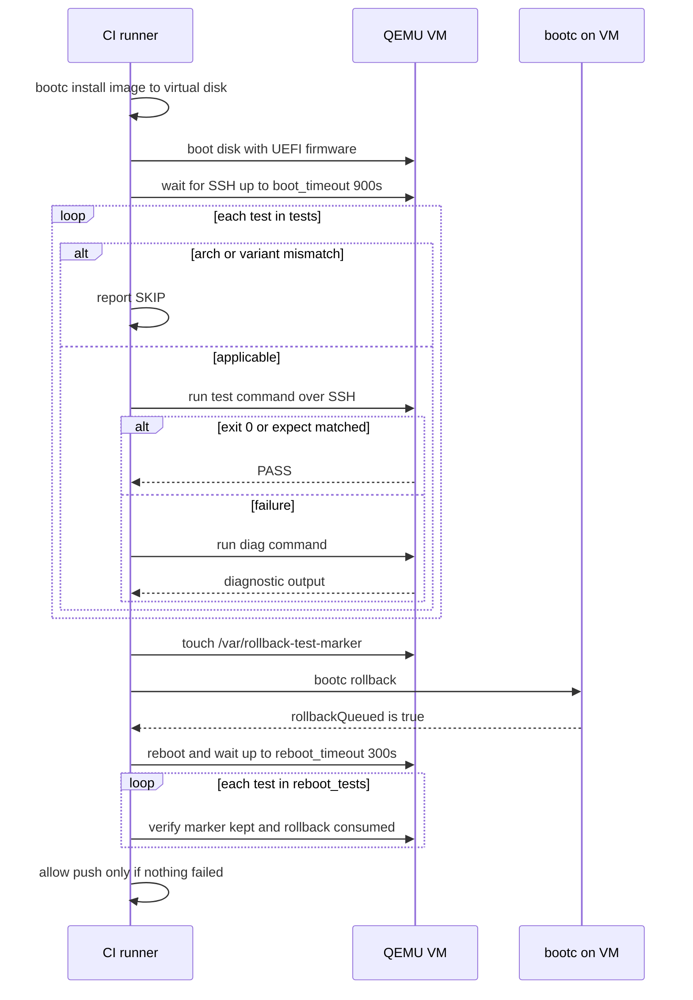

# Image boot test and rollback

This sequence describes how every built image is validated before publication. It starts after `podman build` when the image is installed onto a virtual disk and booted under QEMU/KVM with UEFI, and ends when the pre-reboot `tests` and post-rollback `reboot_tests` from `workflows/tests.yml` all pass, unblocking the push [src: file: workflows/tests.yml:1] [src: file: workflows/tests.yml:311]. Tests carry optional `arch`/`variant` gates (SKIP, not FAIL) and a mandatory `diag` [src: file: workflows/tests.yml:9] [src: file: workflows/tests.yml:13].

