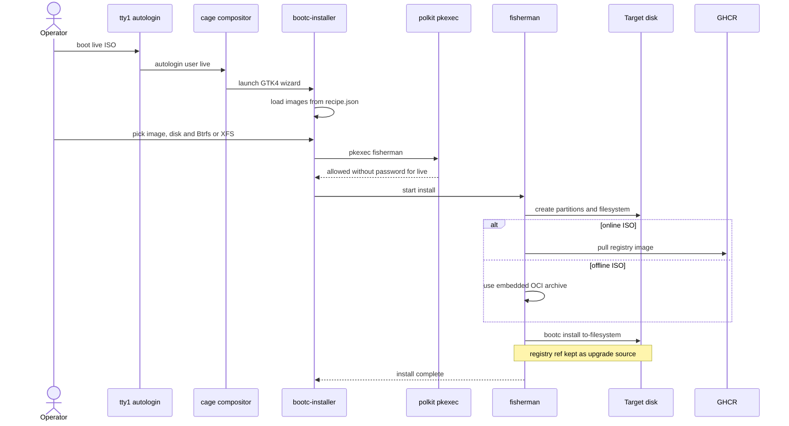

# ISO installation

This sequence describes how the amd64 installer ISO deploys debian-bootc onto a disk. The ISO is built from `Containerfile.iso` on top of `ghcr.io/daemoncores/debian-bootc:latest-${ARCH}-autoupdate` and converted by bootc-image-builder, with the clean base image as the install payload [src: file: Containerfile.iso:16] [src: file: Containerfile.iso:28]. It starts at live boot (autologin on tty1 into cage and the bootc-installer wizard) and ends when fisherman has run `bootc install to-filesystem` on the target disk [src: file: Containerfile.iso:12] [src: file: docs/architecture.md:90].

